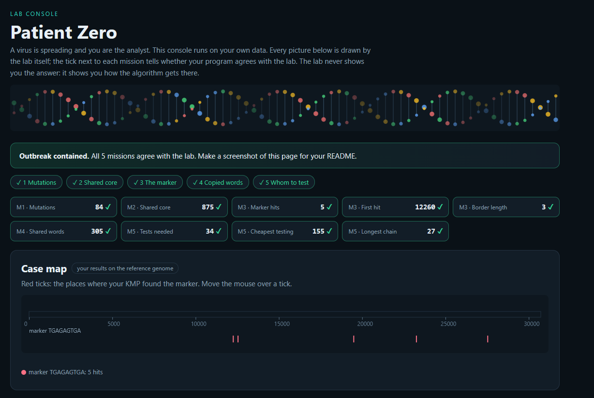

# Assignment 4. Patient Zero

Student ID: 254605
Name: Kassen Alikhan
Group: SE 2540

## Program output

The 9 lines your program prints on your data (`java -cp out Main`):

    Mutations: 84
    Shared core: 875
    Marker hits: 5
    First hit: 12260
    Border length: 3
    Shared words: 305
    Tests needed: 34
    Cheapest testing: 155
    Longest chain: 27

My outbreak report (a screenshot of `output/outbreak.html`):

## Questions

Answer in your own words, two or three sentences each.

Mission 1. d[i][j] is the minimum number of operations needed to change first i letter of a to first j letters of b. If the last letters match it is d[i-1][j-1]. Otherwise it is d[i-1][j-1], d[i-1][j], d[i][j-1]

Mission 2. A common substring must be contiguous in both strains, a common subsequence only needs letters in the same order, with gaps allowed. If one strain has an extra letter early on, everything after it shifts and position by position comparison can't see it, while lcs still pairs those. That's why shared core is bigger than the numbers of letters equal at the same position 

Mission 3. prefix function tells us the length of the longest proper prefix p[i] that is also a suffix. A mismatch in kmp only means fallback to a shorter prefix of p that is still a suffix of the text read so far, which is k = pi[k-1]

Mission 4. there are more possible words than hash values. comparing hashes is what makes them correct. If many windows share a hash, every lookup produces many candidates to compare letter by letter at O(k) each

Mission 5. each person has two states: tested, or not tested, with the cheapest cost of their subtree in each case. If v is tested, its links to children are already covered, so each child takes its cheaper state. If v is not tested, every child must be tested. Greedy fails because it looks only at the number of links and ignores the rest of the tree and the costs

## AI use

Claude was used to review the code and for bug checking

## Timing (Mission 7)

Milliseconds, average of 3 runs, from `java -cp out Bench`.

| test | size | time |
|---|---|---|
| naive search | 20 000 / 40 000 / 80 000 | 55,2 ms 88,7 ms 88,7 ms |
| KMP | 20 000 / 40 000 / 80 000 | 2,5 ms 1,2 ms 0,4 ms |
| edit distance | 500 / 1000 / 2000 / 4000 | 6,2 ms 8,4 ms 14,4 ms 57,9 ms|

What do the numbers say about how the time grows? When you double the size, by how much does each time grow? Two or three sentences.

## Complexity

n is the length of the text (or of a strain), m the length of the pattern, k the length of the window, v the number of people. Fill in every algorithm you wrote.

| algorithm | time | space | assumptions |
|---|---|---|---|
| Edit distance | O(n*m) | O(n*m) | every operations costs 1 (constant time) |
| LCS | O(n*m) | O(n*m) | letters in same order but not one after one |
| Prefix function and KMP | O(m), O(n+m) | O(m), O(k) | comparison cost 1 |
| Rabin-Karp (shared words) | O(n+m) | O(m), O(n) | hash function costs 1 |
| Tree DP | O(V) | O(V) | using recursion due to V < 100 |
